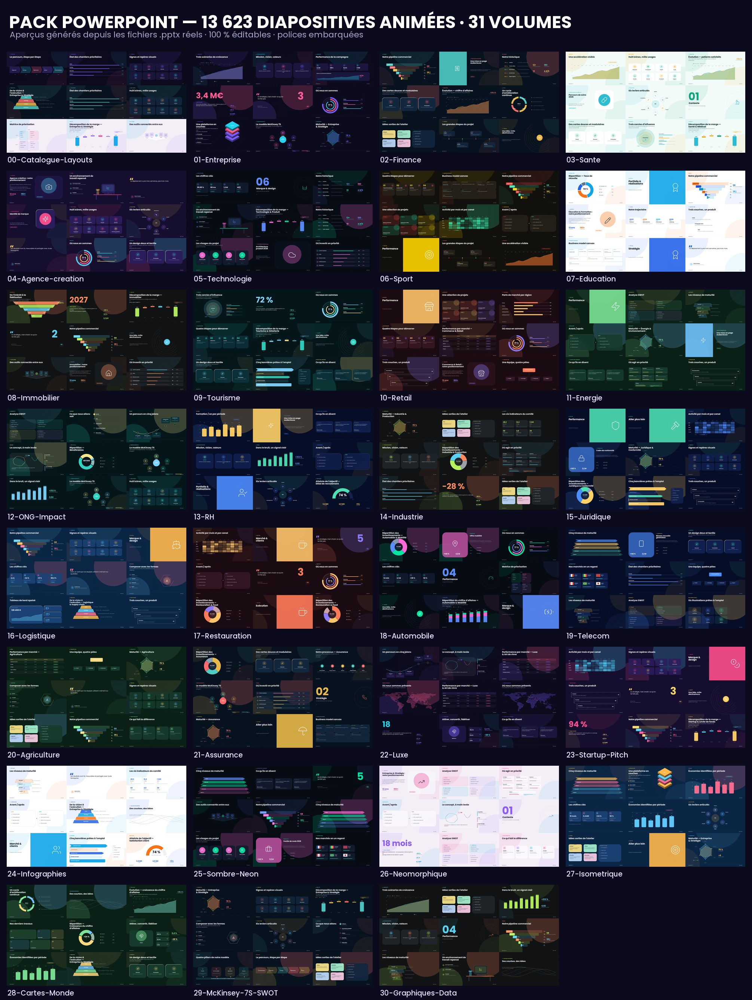

# Pack PowerPoint — 13 623 diapositives animées, 100 % éditables

Un pack complet de modèles PowerPoint professionnels inspiré du design **Infografity** :
formes vectorielles natives, typographie embarquée, animations PowerPoint,
et une banque de contenus par secteur d'activité.

> **13 623 diapositives uniques · 31 fichiers .pptx · 109 933 animations · 98 mises en page**



---

## 1. Ce que contient le pack

| # | Volume | Domaine | Slides |
|---|--------|---------|--------|
| 00 | Catalogue-Layouts | Toutes les mises en page, 3 déclinaisons | 243 |
| 01 | Entreprise | Stratégie, organisation, gouvernance | 446 |
| 02 | Finance | Résultats, budget, investissement | 446 |
| 03 | Santé | Parcours de soins, clinique, prévention | 446 |
| 04 | Agence créative | Identité, campagne, portfolio | 446 |
| 05 | Technologie | Produit, architecture, data | 446 |
| 06 | Sport | Performance, saison, entraînement | 446 |
| 07 | Éducation | Programme, pédagogie, évaluation | 446 |
| 08 | Immobilier | Programme, chantier, valorisation | 446 |
| 09 | Tourisme | Destination, expérience voyageur | 446 |
| 10 | Retail | Plan commercial, assortiment, conversion | 446 |
| 11 | Énergie | Transition, climat, production | 446 |
| 12 | ONG / Impact | Rapport d'impact, projets, terrain | 446 |
| 13 | RH | Marque employeur, talents, formation | 446 |
| 14 | Industrie | OEE, qualité, maintenance | 446 |
| 15 | Juridique | Conformité, risques, politiques | 446 |
| 16 | Logistique | Supply chain, transport, entrepôts | 446 |
| 17 | Restauration | Carte, sourcing, expérience | 446 |
| 18 | Automobile | Mobilité, recharge, réseau | 446 |
| 19 | Télécom | Réseau, couverture, services | 446 |
| 20 | Agriculture | Rendement, irrigation, filières | 446 |
| 21 | Assurance | Parcours assuré, sinistres | 446 |
| 22 | Luxe | Savoir-faire, collection, rareté | 446 |
| 23 | Startup / Pitch | Problème, traction, marché | 446 |
| 24 | Infographies | Bibliothèque purement infographique | 446 |
| 25 | Sombre néon | Style dark / néon | 446 |
| 26 | Néomorphique | Style doux et tactile | 446 |
| 27 | Isométrique | Scènes 3D isométriques | 446 |
| 28 | Cartes du monde | Cartes, routes, focus pays | 446 |
| 29 | McKinsey 7S / SWOT | Cadres de diagnostic | 446 |
| 30 | Graphiques data | Courbes, barres, jauges, tableaux | 446 |

Chaque volume suit la même architecture : **1 diapositive « mode d'emploi » + 5 chapitres × 89 diapositives** (98 mises en page au total, déclinées par peaux), chaque
chapitre ayant sa propre peau (accents, fond, motifs) et des contenus recalibrés
(valeurs de données, ordre des blocs, libellés) — d'où l'unicité des 446 slides.

## 2. Contenu des diapositives (les 37 familles demandées)

| Famille | Où la trouver |
|---|---|
| Modèle McKinsey 7S | `29-McKinsey-7S-SWOT`, chapitre 2 |
| Diapositives du portfolio | tous les volumes, chapitre « Portfolio & réalisations » |
| Style néomorphique | `26-Neomorphique` |
| Illustration isométrique | `27-Isometrique` |
| Graphiques | `30-Graphiques-Data` + tous les volumes |
| Infographie de scène | `24-Infographies`, `27-Isometrique` |
| Infographies de processus | tous les volumes (5 layouts) |
| Infographies circulaires | tous les volumes (`cycle-circular-list`) |
| Infographies sur le cycle | tous les volumes (`cycle-arrows`) |
| Infographies sur les anneaux | tous les volumes (3 layouts) |
| Infographie sur les équipements | `equipment-scene`, `scene-desk`, `isometric-city` |
| Infographies en entonnoir | `funnel-5`, `funnel-stage-scene` |
| Infographies marketing | `marketing-funnel-cards`, `marketing-channel-score` |
| Infographies d'entreprise | `corporate-pillars`, `corporate-timeline-cards` |
| Analyse SWOT | `29-McKinsey-7S-SWOT`, `swot`, `swot-matrix` |
| Infographie chronologique | 3 layouts (`timeline-*`) |
| Infographie pyramidale | `pyramid-4`, `pyramid-maslow` |
| Entonnoir de vente | `funnel-sales` |
| Infographie Arrow | `arrow-steps`, `process-chevron` |
| Diapositives infographiques | `24-Infographies` |
| Diapositives de section Pause | 3 layouts (`section-break*`) |
| Infographie faite à la main | `handmade-sketch`, `handmade-notes` |
| Cartes du monde | `28-Cartes-Monde` (carte vectorielle Natural Earth) |
| Cartes et drapeaux | `flags-grid`, `flags-map-combo` |
| Illustrations | `illustration-abstract`, `illustrations-set` |
| Diagrammes circulaires | `cycle-*`, `rings-four` |
| Figures géométriques | `shape-geometry` |
| Signes et symboles | `symbols-signs` |
| Bannières | `banner-set` |
| Icônes des réseaux sociaux | `social-icons`, `social-post-mock` |
| Mises en page abstraites | `abstract-layout-1/2` |
| Schémas | `scheme-layers`, `business-model-canvas`, `corporate-structure` |
| Graphiques d'entreprise | `corporate-pillars`, `kpi-grid` |
| Infographies sombres | `25-Sombre-Neon` |
| Graphique linéaire | `chart-line`, `chart-line-multi`, `dark-glow-chart` |
| Icônes | `icons-grid-8`, `icons-feature-4` (1 539 icônes Lucide intégrées) |

## 3. Caractéristiques techniques

- **Tout est natif PowerPoint** : chaque forme, icône, carte et graphique est un
  objet vectoriel (`p:sp` / `a:custGeom`), donc **modifiable** (couleur, taille,
  texte, position) — aucune image aplatie.
- **Texte réel** dans des zones de texte, avec césure calculée pour que rien ne
  déborde, quelle que soit la longueur du texte.
- **Animations PowerPoint natives** : chaque slide possède un build (fondu,
  balayage, zoom, cercle, barre, damier…) enchaîné automatiquement, avec des
  delays en cascade. Lisible et modifiable dans le volet Animation.
- **Police embarquée** : Poppins (regular + bold, licence OFL) est incluse dans
  chaque .pptx (`ppt/fonts/*.fntdata`) ; le rendu reste identique même si la
  police n'est pas installée. Fichiers `.ttf` fournis dans `assets/fonts/`.
- **Format 16:9** — 13,333 × 7,5 in (33,87 × 19,05 cm).
- **Palettes** : 15 palettes (midnight, aurora, sunset, graphite, royal, blush,
  light, medical, finance, sport, tech, creative, isometric, earth…).
- **Cartes** : géométries Natural Earth 110m (domaine public) converties en
  polygones éditables, un objet par pays.
- **Icônes** : Lucide (licence ISC), 1 539 icônes converties en formes vectorielles.

## 4. Utilisation

1. Ouvrez le volume correspondant à votre secteur (ex. `02-Finance.pptx`).
2. Dupliquez la diapositive qui vous intéresse dans votre présentation
   (clic droit → *Conserver la mise en forme*).
3. Modifiez les textes : chaque bloc est une zone de texte indépendante.
   Les couleurs se changent via *Format → Remplissage* ou en sélectionnant
   plusieurs formes.
4. Les animations sont déjà en place : lancez le diaporama (`F5`).
5. Pour changer la palette d'un slide : sélectionnez toutes les formes
   (`Ctrl+A`), puis remplacez les couleurs d'accent (violet/cyan/rose…).

## 5. Régénérer ou personnaliser le pack

Le pack est généré par un moteur Python (design system → DrawingML).

```bash
python -m venv .venv && .venv/bin/pip install -r requirements.txt
cd src
.venv/bin/python build.py --only 01 --chapters 1     # un volume d'essai
.venv/bin/python build.py --catalogue                # volume 00
.venv/bin/python build.py                           # pack complet (~9 min)
```

Chaque fichier est ensuite vérifiable :

```bash
python tools/validate.py                 # intégrité, comptage, animations, polices
python tools/make_previews.py            # planches d'aperçu (depuis les .pptx réels)
python tools/pptx_preview.py fichier.pptx sortie/  # rendu slide par slide
```

### Structure du code

```
src/
  ir.py            # représentation intermédiaire de dessin (formes, texte, icônes)
  emit_pptx.py     # IR -> DrawingML natif + animations
  emit_svg.py      # IR -> SVG (aperçu fidèle)
  components.py    # composants de design (cartes, KPI, chips, fonds, peaux)
  theme.py         # palettes, grille, échelle typographique
  variation.py     # moteur de peaux (accents, fonds, motifs)
  textfit.py       # mesure/césure Poppins pour un texte toujours contenu
  iconlib.py       # icônes Lucide -> chemins DrawingML
  geolib.py        # cartes du monde -> polygones éditables
  recipes.py       # recettes : quel layout, quel contenu
  build.py         # générateur de volumes
  layouts/         # 98 mises en page (covers, structure, charts, infographics…)
tools/             # validation, aperçus, planches contact
output/            # les 31 fichiers .pptx
previews/          # planches d'aperçu par volume
```

## 6. Licences

- Code et design : générés pour ce projet.
- Police **Poppins** : SIL Open Font License (`assets/fonts/OFL-Poppins.txt`).
- Icônes **Lucide** : licence ISC (`assets/icons/LICENSE-lucide.txt`).
- Cartes **Natural Earth / world-atlas** : domaine public (`assets/geo/LICENSE-world-atlas.txt`).

Tous les textes sont des exemples génériques : remplacez-les librement.
